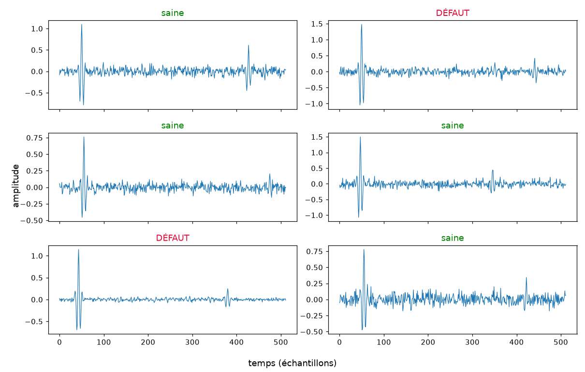
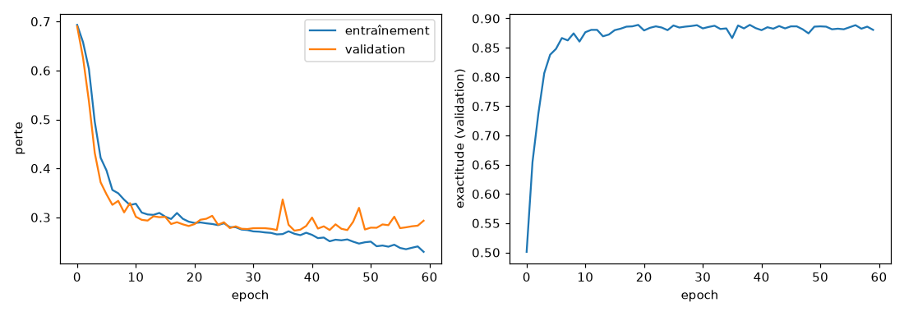
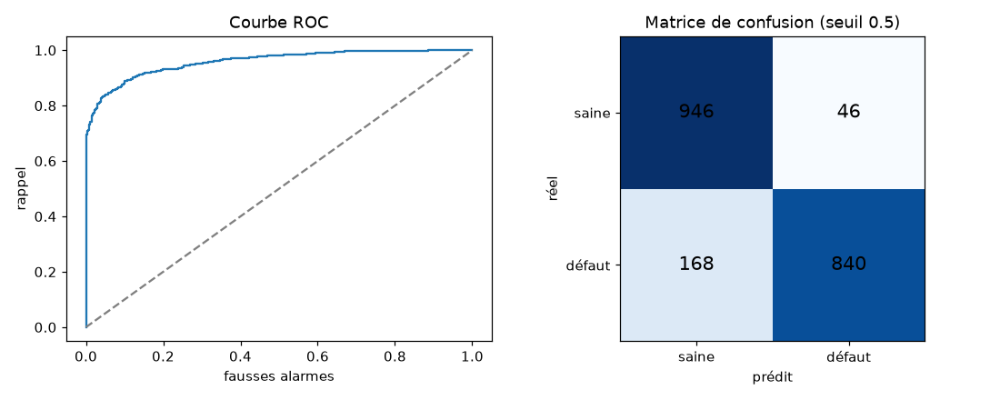
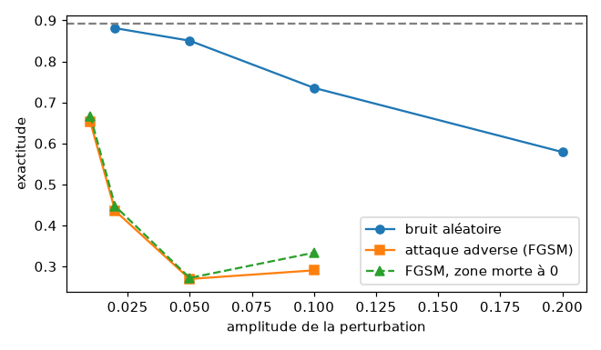

# Détection de défauts sur signaux ultrasonores avec un CNN 1D

Projet de ML engineering de bout en bout : simuler des signaux d'inspection ultrasonore (A-scan), entraîner un réseau de neurones convolutif 1D qui détecte les défauts, l'évaluer honnêtement, tester sa robustesse jusqu'aux attaques adverses, puis le compresser et le déployer (ONNX, quantification INT8, C++ sans bibliothèque, API Flask).

**Les données sont simulées.** Le projet sert à apprendre et à montrer une méthode, pas à prétendre une expertise en contrôle non destructif. La section « Limites » détaille ce qu'il ne prouve pas.

## Résultats en bref

| | |
|---|---|
| Exactitude sur le test (seuil 0,5) | 0,893, intervalle de confiance à 95 % : 0,878 à 0,905 |
| AUC sur le test | 0,958 |
| Au seuil d'inspection (0,15) | 97 % des défauts détectés (30 ratés sur 1 008), 38 % de fausses alarmes |
| Méthode classique (porte fixe) | 0,65 d'exactitude |
| Modèle quantifié INT8 | 56 Ko au lieu de 162, 2 fois plus rapide, aucun défaut raté en plus |
| Inférence en C++ pur | identique à PyTorch à 2 × 10⁻⁶ près |
| Attaque via l'API seule | copie du modèle à 85 % en 30 secondes, 17 % des défauts masqués |

## Le problème

Une sonde envoie une impulsion ultrasonore dans une pièce et enregistre les échos. Sur un A-scan, le grand pic vers l'échantillon 50 est l'écho de la surface d'entrée ; un pic plus faible, plus loin, est l'écho du fond de la pièce, dont la position dépend de son épaisseur. Un défaut ajoute un petit écho entre les deux et affaiblit l'écho de fond. La tâche : classer chaque signal comme sain ou défectueux.



La difficulté vient de la variabilité. D'une pièce à l'autre, l'écho de fond se déplace sur près de 200 échantillons, et une partie des défauts a un écho plus faible que le bruit. Avec plus de bruit (`difficulte=2.0`), on ne repère plus aucun défaut à l'œil.

## Installation

```bash
python3 -m venv .venv
source .venv/bin/activate
pip install -r requirements.txt
```

Testé avec Python 3.14 sur un Mac Apple Silicon. Sur une connexion lente, `pip install --timeout 120 -r requirements.txt` évite les erreurs de délai dépassé.

## Exécution (dans l'ordre)

```bash
python simulateur.py           # images d'exemples de signaux
python 00_backprop_numpy.py    # rétropropagation à la main
python 01_premier_reseau.py    # premier réseau PyTorch
python 02_baseline.py          # méthodes sans réseau de neurones
python 03_train_cnn.py         # entraînement du CNN
python 04_evaluation.py        # métriques, seuil, intervalle de confiance
python 05_robustesse.py        # bruit, étalonnage, décalage, attaque adverse
python 06_export_onnx.py       # export au format ONNX
python 07_quantification.py    # élagage, quantification INT8, latence
python 08_api_flask.py --test  # API de diagnostic (ou sans --test pour la lancer)
python 09_extraction.py        # démonstration d'extraction de modèle par l'API
pytest -v                      # tests de l'API
cd cpp && python exporter_poids.py && g++ -O2 -std=c++17 -o infer infer.cpp && ./infer
```

`03_train_cnn.py` utilise automatiquement la puce graphique des Mac Apple Silicon (backend MPS de PyTorch) et revient sur le processeur ailleurs. Sur un MacBook Pro M5, 60 epochs prennent 23 secondes sur MPS ; le modèle de départ, plus petit, en demandait environ 240 sur le processeur. Avec la même graine sur la même machine, l'entraînement est reproductible à l'octet près.

## Le modèle retenu

Un CNN 1D à 5 blocs [convolution, ReLU, max-pooling] avec des noyaux de 15 échantillons, suivis d'une moyenne globale et d'une couche linéaire : 40 593 paramètres (`modele.py`). Le même filtre glisse sur tout le signal, ce qui permet de reconnaître un écho quelle que soit sa position.

Les réglages ont été choisis sur le jeu de **validation**, un à la fois. Le test n'a servi qu'à la mesure finale.

| Configuration | Paramètres | Meilleure perte val | Exactitude val |
|---|---|---|---|
| 4 blocs, noyau 9 (modèle de départ) | 15 169 | 0,332 | 0,864 |
| 4 blocs, noyau 15 | 25 201 | 0,294 | 0,877 |
| 5 blocs, noyau 15 (retenu) | 40 593 | 0,273 | 0,883 |

Le noyau de 15 couvre près de deux oscillations de l'impulsion ; avec 5 blocs, le champ réceptif (466 échantillons) couvre presque tout le signal utile.

L'entraînement utilise une augmentation de données : à chaque mini-lot, un gain aléatoire (0,7 à 1,3) et un bruit gaussien aléatoire (écart-type jusqu'à 0,1). Un entraînement adverse (FGSM, ε = 0,02) a aussi été essayé puis écarté : il améliore nettement la résistance à cette attaque, mais fait perdre 9 points de rappel sur les signaux normaux.



## Résultats sur le jeu de test simulé

| Méthode | Exactitude | AUC |
|---|---|---|
| Porte fixe avec seuil (méthode classique) | 0,65 | 0,70 |
| Régression logistique sur le signal brut | 0,51 | 0,50 |
| CNN 1D retenu, seuil 0,5 | 0,89 (IC 95 % : 0,88 à 0,91) | 0,96 |

L'intervalle de confiance vient d'un bootstrap (1 000 tirages avec remise des 2 000 signaux de test).

La porte fixe surveille une fenêtre de temps fixe : elle rate les défauts profonds et ne peut pas s'étendre sans attraper l'écho de fond, qui change de place. La régression logistique donne un poids fixe à chaque position du signal et ne sait pas reconnaître un écho « quelque part ».

En inspection, rater un défaut coûte bien plus cher qu'une fausse alarme. Le seuil de décision est donc choisi sur la validation pour détecter au moins 95 % des défauts : à 0,15, le modèle rate 30 défauts sur 1 008 (rappel 0,970), au prix de 38 % de fausses alarmes (précision 0,721). Exiger 99 % de rappel faisait monter les fausses alarmes à 68 % (mesuré avant l'ajout de l'augmentation de données).

Ces chiffres supposent une pièce défectueuse sur deux. Avec 1 % de pièces défectueuses, comme en production, seule une alarme sur 40 environ serait justifiée au seuil 0,15.



## Robustesse

| Perturbation | Sans augmentation | Avec augmentation (retenu) |
|---|---|---|
| aucune | 0,892 | 0,893 |
| bruit +0,1 | 0,716 | 0,736 |
| amplitude ×0,7 (mauvais étalonnage) | 0,844 | 0,890 |
| décalage de 15 échantillons | 0,887 | 0,888 |
| attaque adverse FGSM, ε = 0,02 | 0,372 | 0,435 |

L'augmentation rend le modèle presque insensible à une erreur d'étalonnage de 30 %, sans rien coûter sur les signaux normaux. Le modèle reste très fragile face à une attaque adverse : une perturbation de 2 %, invisible à l'œil, le fait tomber sous le hasard, même quand elle respecte la zone que la normalisation efface.



## Optimisation et déploiement

| | Exactitude | Rappel au seuil 0,15 | Latence par signal | Taille |
|---|---|---|---|---|
| ONNX float32 | 0,893 | 0,970 | 0,05 ms | 162 Ko |
| ONNX INT8 (quantification statique) | 0,892 | 0,973 | 0,03 ms | 56 Ko |
| C++ sans bibliothèque, `-O2` | identique à PyTorch | | 1,9 ms | |

- L'export ONNX donne les mêmes sorties que PyTorch à 6 × 10⁻⁶ près.
- La quantification INT8 ne coûte presque rien, y compris sur le rappel, qui est la métrique de sécurité ici.
- L'élagage sans réentraînement dégrade vite le modèle (0,82 avec 50 % des poids à zéro), mais 3 epochs de réentraînement suffisent à retrouver 0,89 même avec 70 % des poids supprimés.
- Traiter les signaux par lots divise par trois le temps par signal.
- Le C++ naïf, écrit pour comprendre chaque couche, est environ 40 fois plus lent qu'ONNX Runtime. Un bug d'indexation volontaire y fait déclarer saines toutes les pièces, sans aucune erreur : seule la comparaison à PyTorch le révèle.

## Sécurité de l'API

L'API (`08_api_flask.py`) valide chaque entrée (512 nombres finis et bornés), limite la taille des requêtes à 64 Ko, journalise chaque décision sans conserver le signal (seulement une empreinte SHA-256) et expose une route `GET /sante` qui vérifie que le modèle calcule encore. Deux tests `pytest` couvrent un cas valide et un cas invalide.

`09_extraction.py` montre ce que l'API laisse fuir. Un attaquant qui n'a que l'accès à l'API, avec 6 000 signaux sans étiquettes, entraîne en 30 secondes une copie à 85 % d'exactitude (78,6 % s'il ne reçoit que la décision). En attaquant cette copie, il fait passer 17 % des défauts détectés pour des pièces saines, contre 2 % avec un bruit au hasard. Les défenses : ne renvoyer que la décision aux clients qui n'ont pas besoin de la probabilité, ne pas exposer le seuil, authentifier et limiter les requêtes par client, surveiller le journal.

## Limites

Ce que ce projet ne prouve pas :

- **Les données sont simulées.** Le simulateur reproduit la forme générale d'un A-scan, pas la physique réelle. Un modèle qui réussit ici peut échouer sur de vrais signaux, et c'est même le cas le plus probable sans adaptation.
- **Un seul type de défaut.** Dans le simulateur, un défaut est toujours une copie de l'impulsion d'entrée, d'amplitude et de position aléatoires, sans type, taille ni orientation. Son écho et l'ombre qu'il projette sur l'écho de fond sont même tirés indépendamment, ce qui n'a pas de sens physique. Le réseau a appris à reconnaître ce défaut-là.
- **Des classes équilibrées.** Le test contient un défaut sur deux ; en production, les défauts sont rares et la précision s'effondre.
- **Des étiquettes parfaites.** En vrai, obtenir des étiquettes fiables demande des experts et coûte souvent plus cher que tout le reste.
- **Des choix faits sur un seul entraînement.** Chaque configuration n'a été entraînée qu'une fois ; plusieurs écarts entre configurations sont plus petits que l'incertitude de mesure (±1,4 point).
- **Une augmentation réglée sur les perturbations testées.** Le gain et le bruit de l'augmentation couvrent ce que `05_robustesse.py` mesure ensuite ; sur le terrain, il faudrait les choisir d'après les conditions réelles.
- **Une robustesse adverse mesurée avec une seule attaque.** FGSM est une attaque simple ; une attaque plus forte comme PGD donnerait sans doute de moins bons résultats.
- **Un déploiement démonstratif.** L'API n'a ni authentification ni limite de débit ; les latences ont été mesurées sur un MacBook Pro M5, pas sur un appareil embarqué.
- **Je ne suis pas devenu spécialiste du contrôle non destructif.** J'ai appris une méthode : formuler le problème, battre une référence simple, entraîner, évaluer honnêtement, tester la robustesse, optimiser, déployer et penser à la sécurité.

## Structure du dépôt

```
simulateur.py            génération des signaux A-scan simulés
modele.py                le CNN 1D
00_ à 09_*.py            les étapes du projet, à lancer dans l'ordre
cpp/                     inférence en C++ sans bibliothèque
tests/test_api.py        tests de l'API
sorties/                 figures, seuil de décision (les modèles .pt et .onnx sont régénérés par les scripts)
journal.md               journal d'apprentissage
reponses_exercices.md    réponses détaillées aux exercices de chaque étape
```

## Documentation du travail

- [`journal.md`](journal.md) : ce que j'ai compris au fil du projet, les erreurs que j'ai faites et ce qu'elles m'ont appris.
- [`reponses_exercices.md`](reponses_exercices.md) : mes réponses aux exercices de chaque étape, avec les chiffres obtenus.
