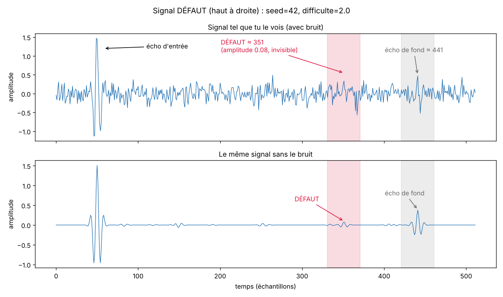
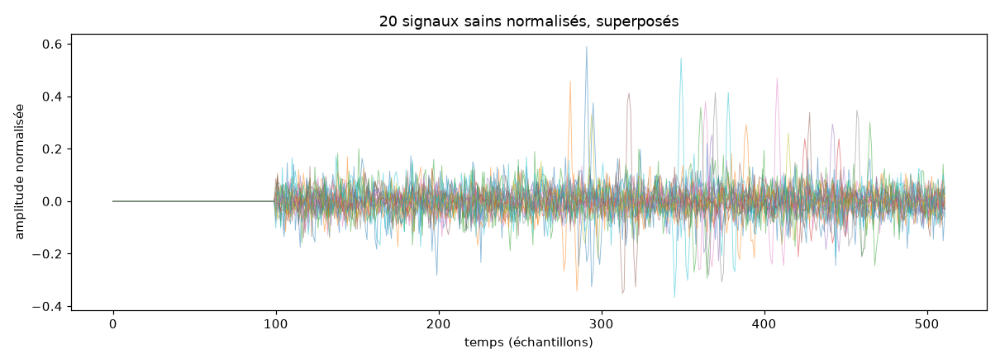
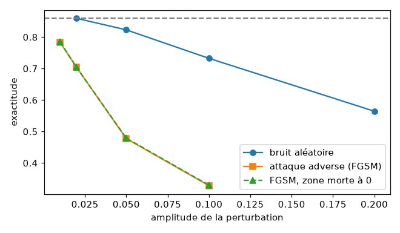
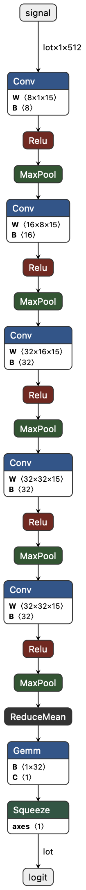

# Réponses aux exercices

Mes réponses aux exercices du guide, étape par étape. Ce que j'ai compris en chemin est dans `journal.md`.

## Étape 0 : rétropropagation à la main (`00_backprop_numpy.py`)

### Exercice 1. Graine 0

À faire : lancer moi-même avec `default_rng(0)` et noter les prédictions obtenues.

D'après un test fait pendant l'exercice 2, avec 4 neurones cachés et la graine 0, la perte reste bloquée vers 0,35 et les prédictions valent `[0.002 0.499 0.999 0.501]`. Deux exemples sur quatre restent autour de 0,5 : le réseau est coincé dans un mauvais minimum, sans erreur ni message.

### Exercice 2. Couche cachée de 4 à 8 neurones

J'ai changé les deux lignes d'initialisation :

```python
W1, b1 = rng.normal(0, 1, (2, 8)), np.zeros((1, 8))
W2, b2 = rng.normal(0, 1, (8, 1)), np.zeros((1, 1))
```

Rien d'autre à modifier : `@`, `.T` et `.sum` s'adaptent aux nouvelles formes.

Avec la graine 0 et 8 neurones, la perte descend à 0,0013 et les prédictions sont `[0.001 0.998 0.999 0.002]`, toutes justes. Ça règle donc le problème pour cette graine.

Un test sur 200 graines montre que ce n'est pas propre à la graine 0 :

| Neurones cachés | Échecs sur 200 graines |
|---|---|
| 2 | 101 (environ 50 %) |
| 4 | 5 (2,5 %) |
| 8 | 0 |
| 16 | 0 |

Passer de 4 à 8 neurones rend l'apprentissage plus robuste à l'initialisation aléatoire : le taux d'échec passe de 2,5 % à 0 % sur 200 graines. Avec plus de neurones, le réseau a plus de chemins vers une solution. Ce n'est pas une garantie : d'autres réglages (taux d'apprentissage, nombre d'étapes) pourraient encore faire échouer un départ.

### Exercice 3. `LR = 5.0` puis `LR = 0.001`

À faire.

### Exercice 4. La ligne qui déplace les poids

Ligne 53 :

```python
W1 -= LR * dW1; b1 -= LR * db1; W2 -= LR * dW2; b2 -= LR * db2
```

Chaque poids recule d'un pas de taille `LR` dans la direction opposée à son gradient, c'est-à-dire vers le bas de la pente de la perte.

## Étape 1 : premier réseau PyTorch (`01_premier_reseau.py`)

Le jeu de test contient 450 images, donc une image vaut environ 0,0022 d'exactitude. Je garde cette échelle en tête pour ne pas surinterpréter les petites variations.

### Exercice 1. 100 epochs

L'exactitude test reste à 0,969 entre les epochs 70 et 90, puis vaut 0,971 aux epochs 95 et 100. Elle se stabilise autour de 97 %. Passer de 0,969 à 0,971, c'est une seule image de plus bien classée : le modèle a atteint un plateau.

### Exercice 2. 8 puis 128 neurones

Avec 128 neurones (`nn.Linear(64, 128), nn.ReLU(), nn.Linear(128, 10)`), l'exactitude finale est de 0,971, avec un pic à 0,976 en cours d'entraînement. L'écart entre le pic et la fin représente deux images, donc je ne l'interprète pas.

À faire : l'essai avec 8 neurones, puis comparer les valeurs finales pour 8, 32 et 128 neurones.

### Exercice 3. Aucune couche cachée

Ma première tentative, `nn.Sequential(nn.Linear(64, 10), nn.ReLU(), nn.Linear(10, 10))`, gardait en fait une couche cachée de 10 neurones (0,958). Le modèle demandé est `nn.Linear(64, 10)` seul.

| Modèle | Paramètres | Perte d'entraînement | Exactitude test | Erreurs sur 450 |
|---|---|---|---|---|
| `nn.Linear(64, 10)` seul | 650 | 0,324 | 0,936 | ≈ 29 |
| couche cachée de 128 | 9 610 | 0,011 | 0,971 | ≈ 13 |

Sans couche cachée, le modèle atteint déjà 93,6 % sur le test, donc ce problème est en grande partie faisable avec une simple somme pondérée des pixels. La couche cachée monte à 97,1 % et divise le nombre d'erreurs par plus de deux. Elle est utile parce qu'elle combine des pixels entre eux, ce qu'un modèle linéaire ne sait pas faire.

Le gain est bien plus faible que ce que suggère la perte d'entraînement, presque 30 fois plus basse avec la couche cachée. Cette perte est mesurée sur les images que le modèle a déjà vues : une partie de l'écart vient de ce que le plus gros modèle colle mieux à l'entraînement, et elle ne se retrouve pas sur des images nouvelles. C'est l'exactitude test qui juge la prédiction.

### Exercice 4. Sans `opt.zero_grad()`

L'exactitude test tombe à 0,536.

PyTorch additionne chaque nouveau gradient dans `.grad` au lieu de le remplacer. Sans remise à zéro, le gradient utilisé à une étape est la somme de tous les gradients depuis le début. La plupart ont été calculés à des endroits où les poids ne sont plus, donc le pas suit surtout l'ancienne pente au lieu de la pente actuelle.

Sur un exemple à une dimension (perte w², départ w = 1, pas de 0,1), w atteint presque 0, le minimum, à l'étape 3. La somme accumulée vaut pourtant encore 4,48, parce qu'elle contient toutes les anciennes pentes positives. Le pas suivant envoie w à -0,45, puis -0,81, puis -1 : le modèle dépasse le minimum et oscille au lieu de s'y arrêter.

L'accumulation est voulue. Quand un poids sert à plusieurs endroits du calcul, son gradient total est la somme de ses contributions, et on peut découper un gros lot en morceaux en appelant `backward()` sur chacun avant un seul `step()`. En contrepartie, il faut remettre les gradients à zéro à chaque étape d'entraînement normale.

## Étape 2 : le simulateur (`simulateur.py`)

### Exercice 1. Repérer les défauts à l'œil avec `difficulte=2.0`

J'ai modifié le bloc principal en `X, y = generer(6, seed=42, difficulte=2.0)`. Sur les 6 signaux, 2 sont étiquetés DÉFAUT (en haut à droite et en bas à gauche).

Ma réponse à l'œil : j'ai cru voir deux défauts sur le signal du haut à droite, et rien sur celui du bas à gauche.

En recalculant ce que le simulateur a réellement placé dans ces signaux, on obtient ceci :

| Signal | Défaut (position, amplitude) | Écho de fond (position, amplitude) | Écart-type du bruit |
|---|---|---|---|
| haut à droite | vers 351, 0,078 | vers 441, 0,37 | 0,156 |
| bas à gauche | vers 284, 0,027 | vers 380, 0,25 | 0,041 |

Un signal défectueux ne contient qu'un seul défaut. Les deux pics que je voyais en haut à droite viennent donc du bruit ou de l'écho de fond (le pic vers 441). Le vrai défaut, vers 351, a une amplitude deux fois plus petite que l'écart-type du bruit : il est invisible. En bas à gauche, la petite bosse vers 380 est l'écho de fond, et le défaut vers 284 est minuscule (0,027).

La figure `sorties/defaut_annote.png` montre le signal du haut à droite deux fois : avec le bruit, tel que je le voyais, puis sans le bruit. Sans bruit, le défaut apparaît comme une petite oscillation vers 351, bien plus faible que l'écho de fond. Avec le bruit, rien ne le distingue des pics voisins.



Résultat : je ne repère correctement aucun des deux défauts. À ce niveau de difficulté, un défaut a la même taille que le bruit, voire moins, et l'œil confond le bruit, l'écho de fond et le défaut. C'est ce que le CNN devra faire mieux que moi, en reconnaissant la forme de l'impulsion plutôt que sa hauteur.

### Exercice 2. Superposer 20 signaux sains normalisés

J'ai ajouté une deuxième figure à la fin du bloc principal de `simulateur.py` : `generer(20, taux_defaut=0.0, seed=7)`, puis `normaliser`, puis les 20 signaux tracés sur le même graphique avec `alpha=0.5`.



Ce qui varie le plus est la position de l'écho de fond. Les 20 signaux sont plats avant l'échantillon 100 (zone morte effacée par la normalisation), se ressemblent entre 100 et 270 (bruit), puis chacun a son grand pic quelque part entre 280 et 460 : c'est son écho de fond.

Le simulateur tire l'épaisseur de la pièce au hasard entre 220 et 420 échantillons, et l'écho de fond arrive à `p_entree + epaisseur`, donc entre 255 et 475. Sa hauteur varie aussi (de 0,25 à 0,6 environ), à cause de l'atténuation tirée au hasard et de l'épaisseur.

Conséquence pour le réseau : il ne peut pas chercher un pic à un endroit fixe. Il doit reconnaître un défaut à n'importe quelle position et le distinguer d'un écho de fond normal qui change de place et de hauteur.

### Exercice 3. La simplification la plus éloignée de la réalité

La modélisation du défaut : un seul type d'écho, toujours de la même forme, sans taille, type ni orientation. Le raisonnement complet est dans `journal.md`, section « La simplification du simulateur la plus éloignée de la réalité ».

## Étape 3 : les méthodes de référence (`02_baseline.py`)

Résultats de départ, identiques à ceux du guide :

```
[porte fixe]  seuil=0.171  exactitude=0.653  rappel=0.607  précision=0.673  AUC=0.704
[logistique]  exactitude=0.505  rappel=0.471  précision=0.510  AUC=0.502
```

La porte fixe fait 65 %, la régression logistique 50,5 %, c'est-à-dire le hasard. Le CNN de l'étape 4 atteint environ 85 % : il bat nettement les deux.

### Exercice 1. Changer la fenêtre de la porte

En changeant `G0, G1`, j'ai obtenu au mieux une exactitude de 0,636 (seuil 0,200), moins bien que les 0,653 de la fenêtre 100 à 230. Ma réponse : non, je ne trouve pas vraiment de meilleure fenêtre. Un balayage systématique des fenêtres confirme qu'on ne gagne presque rien : la meilleure, autour de 100 à 260, donne 0,657 sur le test, soit six images de mieux sur 2 000.

Pourquoi ne pas mettre la porte sur tout le signal ? Ma première idée était le nombre d'entrées, mais ce n'est pas ça : la porte ne fait que prendre le maximum de la fenêtre, quelle que soit sa taille. La vraie raison, c'est l'écho de fond. Il est présent dans tous les signaux, sains ou défectueux, et il est nettement plus grand qu'un défaut. Sur tout le signal, le maximum serait presque toujours l'écho de fond, et le score ne distinguerait plus rien. Le test le confirme : avec la fenêtre 100 à 512, l'exactitude tombe à 0,504, le hasard.

C'est aussi pour ça que la fenêtre s'arrête à 230 : l'écho de fond arrive au plus tôt vers l'échantillon 255 (pièce la plus fine). Mais les défauts peuvent se trouver jusque vers 430 dans les pièces épaisses. Une fenêtre fixe doit donc choisir entre rater ces défauts profonds et attraper l'écho de fond des pièces fines. Comme l'écho de fond change de place d'une pièce à l'autre (exercice 2 de l'étape 2), aucune fenêtre fixe ne règle le problème.

### Exercice 2. Somme des valeurs absolues au lieu du maximum

J'ai remplacé `.max(axis=1)` par `.sum(axis=1)` et adapté la plage de seuils aux valeurs de la somme :

```
[porte fixe]  seuil=3.820  exactitude=0.557  rappel=0.806  précision=0.541  AUC=0.572
```

C'est moins bien : l'exactitude passe de 0,653 à 0,557, et l'AUC de 0,704 à 0,572, pas loin du hasard.

La somme mesure un total sur toute la fenêtre, là où le maximum ne regarde que le plus grand pic. Le problème, c'est ce que contient ce total. Un défaut est un événement local : son écho occupe une dizaine d'échantillons sur les 130 de la fenêtre, avec une petite amplitude. Le bruit et le grain, eux, sont présents sur toute la fenêtre. La somme additionne donc surtout du bruit, et le niveau de bruit varie beaucoup d'un signal à l'autre (le simulateur le tire au hasard). Au final, le score mesure surtout à quel point un signal est bruité, pas s'il contient un défaut. Le maximum, lui, réagit au pic le plus fort, ce qui convient mieux à la recherche d'un écho isolé.

Le rappel élevé (0,806) avec une précision faible (0,541) va dans le même sens : le seuil choisi déclenche l'alarme sur beaucoup de signaux, y compris des signaux sains simplement plus bruités.

### Exercice 3. Choisir le seuil sur la validation plutôt que sur le test

Je n'avais pas trouvé seul. Le jeu de test sert à estimer comment la méthode se comportera sur des pièces qu'elle n'a jamais vues. Pour que cette estimation soit honnête, aucun réglage ne doit avoir été fait en regardant le test. Si on choisit le seuil qui donne le meilleur score sur le test, ce score devient en partie le fruit des particularités de ces 2 000 signaux-là : il est trop optimiste, et il ne dit plus ce qui se passera sur de nouvelles pièces.

Chaque jeu a donc un rôle :

| Jeu | Rôle | Dans le projet |
|---|---|---|
| entraînement | apprendre les poids | `generer(6000, seed=1)` |
| validation | choisir les réglages (seuil, meilleure epoch, architecture) | `generer(2000, seed=2)` |
| test | mesurer une seule fois, à la fin | `generer(2000, seed=3)` |

Exemple chiffré avec la porte fixe. Le seuil choisi sur la validation (0,171) donne 0,6535 sur le test. Le seuil choisi directement sur le test (0,186) affiche 0,6605, ce qui a l'air meilleur. Mais sur 2 000 pièces toutes nouvelles (graine 4), ce seuil fait 0,661, alors que celui de la validation fait 0,6695. Le petit gain affiché sur le test ne se retrouve pas ailleurs : c'était de l'ajustement au test, pas une vraie amélioration.

Ici l'écart est petit, parce qu'on ne règle qu'un seul nombre sur 2 000 signaux. Il grandit quand on fait beaucoup de choix en regardant le test (nombre d'epochs, architecture, plusieurs essais), et on finit par se tromper soi-même sur la qualité du modèle.

## Étape 4 : entraîner le CNN (`03_train_cnn.py`)

Tous les entraînements tournent sur la puce graphique du Mac (MPS), 60 epochs. La référence est le modèle d'origine :

| Configuration | Paramètres | Durée | Meilleure perte val | Exactitude val (même epoch) |
|---|---|---|---|---|
| référence : canaux (8, 16, 32, 32), noyau 9, LR 1e-3 | 15 169 | 16 s | 0,3322 | 0,864 |

### Exercice 1. Nombre de canaux

| Canaux | Paramètres | Durée | Meilleure perte val | Exactitude val |
|---|---|---|---|---|
| (4, 8, 16, 16) | 3 841 | 13 s | 0,3657 (epoch 60) | 0,842 |
| (8, 16, 32, 32) | 15 169 | 16 s | 0,3322 | 0,864 |
| (16, 32, 64, 64) | 60 289 | 20 s | 0,3234 (epoch 29) | 0,864 |

Le petit modèle apprend lentement : il reste bloqué autour de 64 % jusqu'à l'epoch 18 environ, et sa perte de validation baisse encore à l'epoch 60. Il n'a pas fini d'apprendre, et finit un peu en dessous de la référence.

Le grand modèle apprend beaucoup plus vite (84 % dès l'epoch 12), mais il plafonne au même niveau que la référence, vers 86 %. Après l'epoch 30, sa perte d'entraînement continue de baisser (jusqu'à 0,30) alors que celle de validation stagne vers 0,33 en oscillant : les paramètres en plus servent à coller à l'entraînement, pas à mieux généraliser.

Quatre fois plus de paramètres ne donnent donc presque rien. Ce plafond vers 86 % ne vient pas de la taille du réseau mais des données : une partie des défauts a une amplitude plus faible que le bruit, et aucun modèle ne peut les voir.

### Exercice 2. Taille du noyau

| Noyau | Paramètres | Durée | Meilleure perte val | Exactitude val | Champ réceptif après 4 blocs |
|---|---|---|---|---|---|
| 5 | 8 481 | 12 s | 0,4022 (epoch 60) | 0,818 | 76 échantillons |
| 9 | 15 169 | 16 s | 0,3322 | 0,864 | 136 échantillons |
| 15 | 25 201 | 20 s | 0,2941 (epoch 57) | 0,877 | 226 échantillons |

Le champ réceptif est la portion du signal d'origine qu'un neurone de la dernière couche peut voir. Il grandit avec le noyau, et chaque `MaxPool1d(2)` double le pas entre deux positions, donc la contribution des couches profondes. Avec 4 blocs, il vaut 15 × noyau + 1 échantillons.

Le noyau 15 donne le meilleur résultat de tous les essais. Une période de l'impulsion fait environ 8 échantillons (fréquence 0,12 cycle par échantillon) : un filtre de 5 échantillons ne voit même pas une oscillation complète au premier bloc, alors qu'un filtre de 15 en voit près de deux. Les filtres plus larges reconnaissent mieux la forme d'un écho, et le champ réceptif de 226 échantillons permet aux dernières couches de voir un écho avec son contexte.

### Exercice 3. Taux d'apprentissage

| LR | Meilleure perte val | Exactitude val à l'epoch 60 | Comportement |
|---|---|---|---|
| 1e-2 | 0,6931 | 0,501 | ne bouge pas de 0,693 pendant 60 epochs |
| 1e-3 (référence) | 0,3322 | 0,864 | apprend normalement |
| 1e-4 | 0,5753 (epoch 60) | 0,698 | apprend, mais très lentement |

Avec 1e-2, la perte reste collée à ln 2 = 0,693 et l'exactitude à 50 % : le réseau répond au hasard du début à la fin. Les pas sont trop grands, les premières mises à jour envoient les poids dans une zone où le réseau ne réagit plus (par exemple des neurones ReLU qui sortent toujours 0), et il ne s'en remet pas.

Avec 1e-4, les pas sont si petits qu'au bout de 60 epochs le réseau n'a fait qu'une partie du chemin : 70 %, et la perte baisse encore. Il faudrait beaucoup plus d'epochs.

C'est l'image de la montagne de l'étape 0 : des pas trop longs font sauter par-dessus la vallée, des pas trop courts font avancer trop lentement.

### Exercice 4. Observer le surapprentissage

Avec 300 signaux d'entraînement et 100 epochs, j'observe bien que la perte d'entraînement continue de baisser pendant que celle de validation remonte. Le réseau apprend par cœur les 300 signaux au lieu d'apprendre ce qui distingue un défaut.

### Exercice 5. Un cinquième bloc de convolution

Essai fait avec le noyau 15 que j'ai gardé, donc avec `canaux=(8, 16, 32, 32, 32)` et `noyau=15`. La bonne comparaison est le modèle à 4 blocs avec le même noyau :

| Blocs (noyau 15) | Paramètres | Durée | Meilleure perte val | Exactitude val | Champ réceptif |
|---|---|---|---|---|---|
| 4 | 25 201 | 20 s | 0,2941 (epoch 57) | 0,877 | 226 échantillons |
| 5 | 40 593 | 23 s | 0,2728 (epoch 38) | 0,883 | 466 échantillons |

Ma première conclusion était que ça n'aide pas, parce que la courbe de validation passe au-dessus de celle d'entraînement. Ce critère n'est pas le bon : une perte de validation un peu au-dessus de celle d'entraînement est normale. Le surapprentissage se voit quand la perte d'entraînement continue de baisser pendant que celle de validation remonte, ou quand l'écart entre les deux se creuse.

C'est ce qui se passe ici, mais seulement après l'epoch 30 environ : la perte d'entraînement descend de 0,27 à 0,23 pendant que celle de validation stagne puis remonte légèrement, de 0,27 à 0,29. Le réseau commence à apprendre par cœur. Comme le script garde le meilleur modèle selon la validation (epoch 38), ce début de surapprentissage ne pénalise pas le modèle sauvegardé.

Le cinquième bloc aide un peu : la meilleure perte de validation passe de 0,2941 à 0,2728, et le modèle apprend beaucoup plus vite (86,7 % dès l'epoch 7). Le gain en exactitude reste faible, 0,6 point, soit une douzaine de signaux sur 2 000. Avec ce bloc, le champ réceptif passe à 466 échantillons et couvre presque tout le signal utile après la zone morte : la dernière couche peut relier un écho de défaut à l'écho de fond. Le coût, c'est 15 000 paramètres de plus et un surapprentissage plus précoce.

### Exercice 6. Maximum global au lieu de la moyenne

Ma prédiction : le maximum allait prendre l'écho d'entrée, la plus grande valeur du signal. Elle était fausse : la normalisation met les 100 premiers échantillons à zéro (zone morte), donc l'écho d'entrée a disparu avant même d'arriver au réseau. Le plus grand écho qui reste est l'écho de fond, présent dans tous les signaux.

Résultat avec `x.amax(dim=-1)` : meilleure perte de validation 0,3766 (epoch 51), exactitude 0,831, contre 0,3322 et 0,864 avec la moyenne. C'est moins bien, et la validation est plus instable (des creux à 0,79 aux epochs 43 et 47).

Pour chaque canal, le maximum ne garde que la plus forte réponse du filtre sur tout le signal. Un filtre qui réagit à la forme d'un écho réagit aussi, et plus fort, à l'écho de fond, sain ou pas. Le maximum garde donc souvent la réponse à l'écho de fond et jette celle au petit défaut. La moyenne conserve un peu de tout le signal, y compris le petit écho supplémentaire et l'affaiblissement de l'écho de fond causé par le défaut.

## Étape 5 : l'évaluation (`04_evaluation.py`)

Modèle évalué : 5 blocs, noyau 15. C'est la première fois que ce modèle est mesuré sur le test.

```
AUC (test) = 0.956
Seuil standard 0.5                 seuil=0.50  rappel=0.854  précision=0.927  fausses alarmes=0.069  (défauts ratés : 147/1008)
Seuil choisi pour rappel >= 95%    seuil=0.14  rappel=0.962  précision=0.713  fausses alarmes=0.394  (défauts ratés : 38/1008)
```

| | Guide (modèle de départ) | Mon modèle (5 blocs, noyau 15) |
|---|---|---|
| AUC test | 0,922 | 0,956 |
| Défauts ratés à seuil 0,5 | 156 / 1 008 | 147 / 1 008 |
| Fausses alarmes à seuil 0,5 | 13,4 % | 6,9 % |
| Seuil pour un rappel d'au moins 95 % | 0,24 | 0,14 |
| Fausses alarmes à ce seuil | 42,6 % | 39,4 % |

Mon modèle fait mieux que celui du guide sur toutes les lignes. Le gain le plus net est sur les fausses alarmes à seuil 0,5, divisées par deux.


### Le scénario des défauts rares

Le jeu de test contient une pièce défectueuse sur deux. En production, les défauts sont rares. Avec 1 % de pièces défectueuses et mes chiffres, pour 10 000 pièces (100 défectueuses, 9 900 saines) :

| Seuil | Défauts trouvés | Défauts ratés | Fausses alarmes | Précision |
|---|---|---|---|---|
| 0,14 (rappel ≥ 95 %) | 96 | 4 | 3 901 | 96 / 3 997 ≈ 2,4 % |
| 0,5 | 85 | 15 | 683 | 85 / 768 ≈ 11 % |

Au seuil 0,14, seule une alarme sur 40 environ correspond à un vrai défaut : les inspecteurs passeraient presque tout leur temps sur des pièces saines. Au seuil 0,5, les alarmes sont plus souvent justifiées, mais 15 défauts sur 100 passent. Le même modèle, avec la même AUC, peut sembler bon sur un jeu équilibré et être difficile à utiliser quand l'événement recherché est rare. La précision dépend de la proportion de défauts, alors que le rappel et le taux de fausses alarmes n'en dépendent pas.

### Exercice 1. `CIBLE` à 0,99

```
Seuil choisi pour rappel >= 99%    seuil=0.06  rappel=0.992  précision=0.596  fausses alarmes=0.684  (défauts ratés : 8/1008)
```

| Cible de rappel | Seuil | Rappel test | Défauts ratés | Fausses alarmes | Précision |
|---|---|---|---|---|---|
| aucune (seuil 0,5) | 0,50 | 0,854 | 147 | 6,9 % | 0,927 |
| 95 % | 0,14 | 0,962 | 38 | 39,4 % | 0,713 |
| 99 % | 0,06 | 0,992 | 8 | 68,4 % | 0,596 |

Les fausses alarmes passent de 39,4 % à 68,4 % : plus des deux tiers des pièces saines déclenchent l'alarme. Pour trouver 30 défauts de plus (de 38 à 8 ratés), on paie environ 290 fausses alarmes supplémentaires sur les 992 pièces saines, soit près de 10 fausses alarmes par défaut récupéré. Entre le seuil 0,5 et 0,14, on récupérait 109 défauts pour environ 320 fausses alarmes de plus, soit 3 par défaut.

Chaque défaut supplémentaire coûte donc de plus en plus cher. Les derniers défauts sont ceux que le modèle distingue le moins bien, sans doute ceux dont l'écho est plus faible que le bruit : pour les attraper, il faut descendre le seuil presque à zéro et accepter presque tout.

À ce stade, le modèle se rapproche d'une règle qui déclarerait toutes les pièces défectueuses. Cette règle aurait un rappel de 100 % et une précision de 0,504 (la proportion de défauts dans le test) ; à 0,596, le modèle ne fait plus beaucoup mieux.

### Exercice 2. Calcul à la main à seuil 0,5

À partir de la matrice de confusion (924 vrais négatifs, 68 faux positifs, 147 faux négatifs, 861 vrais positifs) :

- rappel = 861 / (861 + 147) = 861 / 1 008 = 0,854 ;
- précision = 861 / (861 + 68) = 861 / 929 = 0,927 ;
- taux de fausses alarmes = 68 / (68 + 924) = 68 / 992 = 0,069 ;
- exactitude = (924 + 861) / 2 000 = 0,893.

Les trois premiers chiffres sont exactement ceux affichés par le script.

### Exercice 3. Intervalle de confiance par bootstrap

J'ai ajouté dans `04_evaluation.py`, après le rapport à seuil 0,5, un bootstrap sur l'exactitude du test : 1 000 tirages de 2 000 signaux avec remise parmi les prédictions, l'exactitude calculée à chaque tirage, puis les percentiles 2,5 % et 97,5 %.

```
Exactitude (test, seuil 0.5) = 0.892  intervalle de confiance à 95 % : [0.878 ; 0.905]
```

L'exactitude vaut 0,892, avec un intervalle de confiance à 95 % de 0,878 à 0,905, soit environ ±1,4 point, conforme aux ±1,5 point annoncés par le guide.

Chaque tirage avec remise fabrique un jeu de test imaginaire, un peu différent du vrai : certains signaux y apparaissent plusieurs fois, d'autres pas du tout. La dispersion des 1 000 exactitudes obtenues montre de combien le résultat aurait pu varier avec un autre échantillon de 2 000 pièces.

Conséquence pour mes choix de l'étape 4 : l'écart d'exactitude entre les modèles à 4 et 5 blocs (0,6 point) est plus petit que cette incertitude. Il pourrait venir du hasard de l'échantillon. L'écart de perte de validation, plus net, reste l'argument le plus solide pour avoir gardé 5 blocs.

### Exercice 4. Pourquoi le seuil sur la validation ?

Ma réponse : on le fait pour ne pas être trop optimiste quant à la capacité du modèle à bien fonctionner.

Version plus précise : si on choisissait le seuil sur le test, il s'ajusterait à ces signaux-là, et le score du test, devenu trop optimiste, ne dirait plus comment le modèle se comportera sur des pièces nouvelles (voir l'exercice 3 de l'étape 3).

## Étape 6 : la robustesse (`05_robustesse.py`)

### Exercice 1. Augmentation de données

Dans `03_train_cnn.py`, chaque mini-lot d'entraînement reçoit maintenant, avant la passe avant, un gain tiré entre 0,7 et 1,3 et un bruit gaussien d'écart-type tiré entre 0 et 0,1, différents pour chaque signal. La validation n'est pas augmentée. J'ai gardé le modèle d'avant dans `sorties/cnn_sans_augmentation.pt`, et `05_robustesse.py` prend maintenant le modèle à tester en argument, pour comparer les deux sans les mélanger.

| Perturbation | Sans augmentation | Avec augmentation | Écart |
|---|---|---|---|
| aucune | 0,892 | 0,893 | +0,1 |
| bruit +0,02 | 0,882 | 0,881 | −0,1 |
| bruit +0,05 | 0,845 | 0,851 | +0,6 |
| bruit +0,1 | 0,716 | 0,736 | +2,0 |
| bruit +0,2 | 0,562 | 0,579 | +1,7 |
| amplitude ×0,7 | 0,844 | 0,890 | +4,6 |
| amplitude ×1,3 | 0,884 | 0,896 | +1,2 |
| décalage −15 | 0,871 | 0,868 | −0,3 |
| décalage +15 | 0,887 | 0,888 | +0,1 |
| attaque ε = 0,01 | 0,600 | 0,652 | +5,2 |
| attaque ε = 0,02 | 0,372 | 0,435 | +6,3 |
| attaque ε = 0,05 | 0,233 | 0,270 | +3,7 |
| attaque ε = 0,1 | 0,289 | 0,290 | +0,1 |

(Exactitude sur les 2 000 signaux de test ; l'écart est en points. L'intervalle de confiance de l'étape 5 est d'environ ±1,4 point.)


Sans perturbation, le modèle augmenté fait aussi bien que l'ancien : l'augmentation ne coûte rien sur les signaux normaux.

Le gain le plus net concerne l'étalonnage : avec une amplitude réduite de 30 %, l'exactitude passe de 0,844 à 0,890, presque le niveau sans perturbation. Le modèle a vu des gains entre 0,7 et 1,3 pendant l'entraînement et a appris à ne pas en dépendre.

Pour le bruit, le gain est réel mais modeste : +2 points à 0,1 et +1,7 à 0,2, juste au-dessus de la marge d'incertitude. À 0,2, au-delà de ce que le modèle a vu à l'entraînement (0,1 au plus), il reste proche du hasard, et son rappel de 0,935 montre qu'il déclare presque tout défectueux. Le décalage ne change pas : le modèle y était déjà peu sensible grâce aux convolutions.

Résultat inattendu : l'augmentation améliore aussi un peu la résistance à l'attaque adverse (+5 à +6 points pour ε = 0,01 et 0,02), alors qu'elle n'a pas été conçue pour ça. Un modèle habitué au bruit réagit un peu moins violemment à de petites perturbations de l'entrée. Il reste quand même très fragile : à ε = 0,02, invisible à l'œil, il tombe à 43,5 %, moins bien que le hasard.

Pendant l'entraînement, la perte d'entraînement (vers 0,37) reste maintenant au-dessus de celle de validation (vers 0,27). Ce n'est pas un problème : les signaux d'entraînement sont rendus plus difficiles par l'augmentation, alors que la validation reste propre.

Je garde le modèle augmenté pour la suite du projet.

Avec le modèle augmenté, `04_evaluation.py` donne : AUC 0,958, exactitude 0,893 [0,878 ; 0,905], et un nouveau seuil de 0,15 pour un rappel d'au moins 95 %. À ce seuil, le modèle rate 30 défauts sur 1 008 au lieu de 38, avec un peu moins de fausses alarmes (38,2 % au lieu de 39,4 %). À seuil 0,5, il rate un peu plus de défauts (168 au lieu de 147) mais fait moins de fausses alarmes (4,6 % au lieu de 6,9 %) : c'est le seuil choisi qui compte, et à ce seuil le modèle augmenté est meilleur.

### Exercice 2. L'attaque en gardant la zone morte à zéro

J'ai ajouté à `05_robustesse.py` une deuxième version de l'attaque FGSM : même direction, mais avec les 100 premiers échantillons remis à zéro, comme le fait la normalisation. Modèle testé : le modèle augmenté.

| ε | Attaque d'origine | Zone morte à zéro | Écart |
|---|---|---|---|
| 0,01 | 0,652 | 0,667 | +1,5 |
| 0,02 | 0,435 | 0,447 | +1,2 |
| 0,05 | 0,270 | 0,272 | +0,2 |
| 0,1 | 0,290 | 0,334 | +4,4 |

Ça ne change presque rien. Jusqu'à ε = 0,05, les écarts restent dans la marge d'incertitude (±1,4 point) : l'attaque garde toute son efficacité sans toucher à la zone morte. Elle passe donc par la partie du signal qui survit au prétraitement, et un attaquant n'a pas besoin de cette zone. L'attaque d'origine n'était pas irréaliste sur ce point : la menace est réelle.

Seul l'écart à ε = 0,1 dépasse la marge (+4,4 points). À cette amplitude, l'attaque d'origine est d'ailleurs moins efficace qu'à ε = 0,05 (0,290 contre 0,270). FGSM fait un seul pas dans la direction du gradient calculé au point de départ ; quand ce pas devient grand, cette direction ne décrit plus bien le modèle, et l'attaque perd en efficacité. Les différences entre les deux versions à ε = 0,1 tiennent probablement à cet effet plus qu'à la zone morte elle-même.


### Exercice 3. L'entraînement adverse (adversarial training)

En trois phrases : pendant l'entraînement, on fabrique à chaque étape des versions attaquées des signaux du lot (par exemple avec FGSM), calculées avec le modèle tel qu'il est à ce moment-là. On entraîne le modèle sur ces signaux attaqués, avec leur vraie étiquette, en plus des signaux normaux. Il apprend ainsi à donner la même réponse pour un signal et pour sa version légèrement perturbée, ce qui rend les petites perturbations ciblées beaucoup moins efficaces.

Implémentation dans `03_train_cnn.py` (réglages `ADVERSAIRE = True` et `EPS_ADV = 0.02`) : pour chaque mini-lot, on calcule le gradient de la perte par rapport à l'entrée, on en déduit la version attaquée des signaux, on jette les gradients des poids calculés pour l'attaque, puis on entraîne sur le lot normal et le lot attaqué réunis. Le modèle précédent (augmenté, sans entraînement adverse) est gardé dans `sorties/cnn_augmente.pt`.

Le modèle entraîné de façon adverse est gardé dans `sorties/cnn_adversaire.pt`. L'entraînement a pris 53 secondes au lieu de 23.

| Perturbation | Augmenté | Augmenté + adverse | Écart |
|---|---|---|---|
| aucune (exactitude) | 0,893 | 0,861 | −3,2 |
| aucune (rappel) | 0,833 | 0,741 | −9,2 |
| bruit +0,05 | 0,851 | 0,823 | −2,8 |
| bruit +0,1 | 0,736 | 0,733 | −0,3 |
| amplitude ×0,7 | 0,890 | 0,841 | −4,9 |
| attaque ε = 0,01 | 0,652 | 0,783 | +13,1 |
| attaque ε = 0,02 | 0,435 | 0,704 | +26,9 |
| attaque ε = 0,05 | 0,270 | 0,477 | +20,7 |
| attaque ε = 0,1 | 0,290 | 0,328 | +3,8 |



La défense marche contre l'attaque qu'il a vue à l'entraînement : à ε = 0,02, l'exactitude passe de 43,5 % à 70,4 %. Elle aide encore à ε = 0,05, mais le modèle y reste sous le hasard (47,7 %), et elle ne protège presque plus à ε = 0,1, au-delà de ce qu'il a appris.

Le prix est lourd. Sur les signaux normaux, l'exactitude baisse de 3,2 points et surtout le rappel de 9,2 points : à seuil 0,5, le modèle rate beaucoup plus de défauts. La résistance au bruit et à l'erreur d'étalonnage se dégrade aussi. La meilleure perte de validation passe de 0,264 à 0,337.

Deux réserves. Le modèle est évalué avec la même attaque (FGSM) que celle qui a servi à l'entraîner, ce qui peut surestimer la protection ; une attaque plus forte comme PGD serait le vrai test. Et les deux versions de l'attaque (avec ou sans zone morte) donnent maintenant exactement les mêmes chiffres : le modèle semble avoir appris à ignorer complètement la zone morte.

Décision : pour une inspection, rater des défauts coûte plus cher qu'être vulnérable à une attaque dont la menace reste à démontrer (exercice 4). Je garde le modèle augmenté sans entraînement adverse pour la suite (`ADVERSAIRE = False`). L'entraînement adverse reste une option documentée si l'analyse de menace la justifie.

### Exercice 4. Raisonnement de menace

Le raisonnement complet (qui, où, accès nécessaire, défenses) est dans `journal.md`, section « Raisonnement de menace : qui pourrait attaquer un signal d'inspection ? ».

En résumé : les attaquants les plus crédibles ne sont pas des concurrents, mais ceux qui ont intérêt à faire passer des pièces défectueuses et un accès à la chaîne (fournisseur ou sous-traitant fraudeur, employé malveillant, acteur étatique visant une infrastructure critique). La condition principale est de pouvoir modifier le signal numérique entre l'appareil et le modèle, et de connaître le modèle ou d'en avoir une copie approchée. Les défenses les plus efficaces sont l'intégrité des données (signature, chiffrement), le contrôle d'accès et la journalisation, avant l'entraînement adverse.

## Étape 7 : l'export ONNX (`06_export_onnx.py`)

Résultat de l'export du modèle retenu (5 blocs, noyau 15, augmentation) :

```
Écrit : sorties/cnn.onnx
Écart max PyTorch vs ONNX Runtime : 6.20e-06
```

Sur 200 signaux de test, la plus grande différence entre les sorties de PyTorch et d'ONNX Runtime est de 6 millionièmes, sous la tolérance de 1e-4 fixée par le script. Elle vient des arrondis : les deux moteurs calculent en nombres à virgule flottante sur 32 bits, mais pas exactement dans le même ordre. Elle est sans effet sur les décisions, puisqu'un logit doit franchir un seuil pour changer de classe et que ces écarts sont des milliers de fois plus petits.

### Exercice 1. Le modèle dans Netron

En ouvrant `sorties/cnn.onnx` dans Netron, je retrouve exactement mon modèle : l'entrée `signal` de forme lot × 1 × 512, puis 5 blocs Conv, Relu, MaxPool avec des poids de forme 8×1×15, 16×8×15, 32×16×15, 32×32×15 et 32×32×15 (le 15 est la taille du noyau), puis `ReduceMean` (la moyenne globale), `Gemm` (la couche linéaire finale, poids 1×32) et `Squeeze`, qui donne la sortie `logit` de forme lot.



Netron compte 40 594 paramètres, un de plus que PyTorch (40 593). La différence vient probablement d'une petite constante ajoutée par l'export, comme l'axe à supprimer pour l'opération `Squeeze`, que Netron compte avec les poids.

### Exercice 2. Un signal de 500 échantillons

Ma première tentative, `Xte[:200].reshape(200, 1, 500)`, échouait avant même d'arriver à ONNX Runtime : NumPy refusait de ranger 200 × 512 = 102 400 valeurs dans 200 × 1 × 500 = 100 000 cases. `reshape` réorganise les valeurs mais n'en ajoute ni n'en retire jamais. Il fallait d'abord couper les signaux : `Xte[:200, :500].reshape(200, 1, 500)`.

ONNX Runtime refuse alors l'entrée :

```
INVALID_ARGUMENT : Got invalid dimensions for input: signal for the following indices
 index: 2 Got: 500 Expected: 512
```

L'index 2 est la troisième dimension de l'entrée (lot, canal, longueur), donc la longueur du signal : il a reçu 500 et attendait 512. À l'export, seul l'axe 0 (le nombre de signaux) a été déclaré variable avec `dynamic_axes` ; la longueur a été figée à 512.

Le réseau lui-même pourrait traiter un signal d'une autre longueur, grâce aux convolutions et à la moyenne globale. C'est le fichier ONNX qui impose la contrainte, et c'est plutôt une bonne chose : le modèle a été entraîné sur des signaux de 512 points, avec une zone morte de 100 points et des échos placés à des positions précises. Un appareil qui enverrait des signaux d'une autre longueur, par exemple avec une autre fréquence d'échantillonnage, est rejeté avec une erreur claire au lieu de donner des prédictions fausses sans prévenir. En pratique, il faudrait adapter les signaux à 512 points dans le prétraitement, avec un rééchantillonnage qui respecte l'échelle de temps.

## Étape 8 : l'optimisation (`07_quantification.py`)

Résultats avec le modèle retenu (5 blocs, noyau 15, augmentation, 40 593 paramètres), comparés à ceux du guide (modèle de départ, 15 169 paramètres) :

| Élagage (sans réentraînement) | Guide | Mon modèle |
|---|---|---|
| 0 % | 0,856 | 0,893 |
| 30 % | 0,606 | 0,885 |
| 50 % | 0,502 | 0,821 |
| 70 % | 0,504 | 0,742 |
| 90 % | 0,504 | 0,504 |

| Quantification | Exactitude | Latence par signal | Taille |
|---|---|---|---|
| float32 | 0,893 | 0,053 ms | 162,2 Ko |
| int8 | 0,892 | 0,028 ms | 55,7 Ko |

Mon modèle supporte beaucoup mieux l'élagage que celui du guide : avec 30 % des poids mis à zéro, il ne perd que 0,8 point, alors que le modèle du guide tombe à 60 %. Avec 2,7 fois plus de paramètres, il a plus de redondance : plusieurs poids font en partie le même travail, et en supprimer une partie abîme moins le résultat. Au-delà de 50 %, il se dégrade quand même nettement, et à 90 % il répond au hasard. Comme le rappelle le script, ces zéros ne rendent pas le calcul plus rapide : ils sont quand même multipliés.

La quantification INT8 est presque gratuite ici : 0,1 point d'exactitude perdu (contre 1 point dans le guide), un calcul 1,9 fois plus rapide et un fichier 2,9 fois plus petit. Le gain de taille est plus proche du facteur 4 théorique (32 bits contre 8) que dans le guide (2,2), parce que les poids représentent une plus grande part du fichier quand le modèle est plus gros ; le reste (échelles, structure du graphe) pèse relativement moins.

Les deux avertissements `Please consider to run pre-processing before quantization` sont sans conséquence ici : ONNX Runtime propose une étape facultative qui prépare le graphe avant de le quantifier.

### Exercice 2. Latence selon la taille du lot

J'ai ajouté à la fin de `07_quantification.py` une mesure du temps de traitement d'un lot entier, en un seul appel, pour 1, 16 et 128 signaux (médiane sur 200 appels après un échauffement).

| Modèle | Lot | Lot entier | Par signal |
|---|---|---|---|
| float32 | 1 | 0,064 ms | 0,064 ms |
| float32 | 16 | 0,349 ms | 0,022 ms |
| float32 | 128 | 2,537 ms | 0,020 ms |
| int8 | 1 | 0,028 ms | 0,028 ms |
| int8 | 16 | 0,276 ms | 0,017 ms |
| int8 | 128 | 2,127 ms | 0,017 ms |

Traiter les signaux par lots coûte beaucoup moins cher par signal : en float32, un signal revient à 0,064 ms seul et à 0,020 ms dans un lot de 128, trois fois moins. Chaque appel a un coût fixe (préparer le calcul, vérifier l'entrée) qui est partagé entre tous les signaux du lot, et le processeur calcule plus efficacement sur de gros blocs de données. Le gain se tasse vite : presque tout est acquis dès 16 signaux.

L'avantage de l'int8 dépend aussi de la taille du lot. Il est 2,3 fois plus rapide pour un signal seul, mais seulement 1,3 fois pour 16 signaux et 1,2 fois pour 128. Pour un signal seul, le coût fixe domine, et le modèle int8 le réduit davantage ; dans un gros lot, c'est le calcul lui-même qui domine, et sur ce processeur l'int8 ne l'accélère que d'environ 20 %.

Le bon réglage dépend de l'usage. Si l'appareil doit répondre à chaque mesure immédiatement, on travaille signal par signal et l'int8 divise le temps par deux. Si on analyse un balayage complet après coup, on regroupe les signaux et l'int8 apporte surtout un modèle trois fois plus petit. Dans les deux cas, les temps (quelques centièmes de milliseconde par signal) sont largement suffisants sur ce processeur ; sur un petit processeur embarqué, ils seraient bien plus grands, et c'est là que l'int8 compterait vraiment.

Le temps d'un signal seul en float32 était de 0,054 ms au début du script et de 0,064 ms ici : les mesures de latence varient d'une exécution à l'autre, d'où l'intérêt de regarder des ordres de grandeur et des rapports plutôt que la troisième décimale.

### Exercice 3. Statique ou dynamique, après ou pendant l'entraînement

1. Les poids sont toujours quantifiés à l'avance ; la différence porte sur les activations, les valeurs qui circulent entre les couches pendant le calcul.
2. En quantification statique (celle du script), on fait passer des signaux de calibration (la classe `Calibration`, 200 signaux) pour fixer une fois pour toutes l'échelle de chaque activation : le calcul est ensuite rapide, mais tout dépend de la représentativité de ces signaux.
3. En quantification dynamique, l'échelle des activations est recalculée à chaque passage : souvent un peu plus précis, mais plus lent ; ONNX Runtime la conseille plutôt pour les RNN et les transformers, et la statique pour les CNN comme le mien.
4. La quantification après l'entraînement (statique ou dynamique) convertit un modèle déjà entraîné, sans le toucher : c'est simple et rapide, mais le modèle n'a jamais appris à vivre avec ces arrondis.
5. La quantification pendant l'entraînement (QAT) simule les arrondis 8 bits dès l'entraînement pour que les poids s'y adaptent : plus coûteuse, elle sert quand la quantification après coup perd trop de précision, ce qui n'est pas mon cas (0,1 point perdu).

Source : documentation d'ONNX Runtime, « Quantize ONNX Models » (https://onnxruntime.ai/docs/performance/model-optimizations/quantization.html).

### Exercice 1. Réentraîner après élagage

J'ai ajouté à `07_quantification.py` une section qui élague le modèle puis le réentraîne 3 epochs (Adam, LR 1e-3, lots de 64). Le masque d'élagage reste en place : les poids supprimés restent à zéro, seuls les poids restants s'ajustent.

| Poids supprimés | Avant réentraînement | Après 3 epochs |
|---|---|---|
| 0 % (référence) | 0,893 | |
| 50 % | 0,821 | 0,894 |
| 70 % | 0,742 | 0,891 |
| 90 % | 0,504 | 0,794 |

Oui, on récupère la performance, et très vite. À 50 % et 70 %, trois epochs suffisent pour revenir au niveau du modèle complet : la moitié, voire les trois quarts des poids étaient en trop pour ce problème. À 90 %, il ne reste qu'environ 4 000 poids ; le modèle repart du hasard et remonte à 79 %, sans rattraper le modèle complet en 3 epochs. C'est cohérent avec l'étape 4, où le petit modèle `(4, 8, 16, 16)`, avec 3 841 paramètres, atteignait 84 % mais en 60 epochs.

L'élagage seul abîme le modèle parce qu'il supprime des poids sans que les autres aient l'occasion de compenser. Le réentraînement donne cette occasion. Ces poids à zéro ne rendent toujours pas le calcul plus rapide, mais un modèle élagué à 70 % puis réentraîné pourrait être compressé efficacement, ou combiné à de l'élagage structuré (retirer des filtres entiers) pour vraiment gagner en vitesse.

Le réentraînement s'est fait sans augmentation de données, et les modèles réentraînés ne sont pas sauvegardés : c'est une expérience, pas un changement du modèle de référence.

### Exercice 4. Le rappel après quantification

J'ai ajouté au tableau de quantification le rappel au seuil 0,5 et au seuil d'inspection choisi à l'étape 5 (0,15, lu dans `sorties/seuil.json`), ainsi que le nombre de défauts ratés à ce seuil.

| Modèle | Exactitude | Rappel à 0,5 | Rappel à 0,15 | Défauts ratés (sur 1 008) |
|---|---|---|---|---|
| float32 | 0,893 | 0,833 | 0,970 | 30 |
| int8 | 0,892 | 0,840 | 0,973 | 27 |

La quantification ne fait pas perdre de rappel : le modèle int8 rate même 3 défauts de moins au seuil d'inspection. L'écart est trop petit pour parler d'amélioration (3 signaux sur 1 008) ; il vient des arrondis, qui décalent légèrement les probabilités. Comme l'exactitude baisse d'un signal, le modèle int8 fait probablement un peu plus de fausses alarmes en échange.

Oui, le rappel est plus important ici que l'exactitude. Un défaut raté laisse partir une pièce défectueuse, alors qu'une fausse alarme ne coûte qu'un contrôle de plus. L'exactitude mélange les deux erreurs : une quantification pourrait faire rater plusieurs défauts de plus tout en évitant autant de fausses alarmes, sans que l'exactitude bouge. Il faut aussi mesurer le rappel au seuil d'inspection, pas seulement à 0,5 : c'est près de ce seuil bas que se trouvent les défauts difficiles, ceux qu'un petit décalage de probabilité peut faire basculer. Avant d'embarquer un modèle quantifié dans un appareil, c'est cette vérification qui compte.

## Étape 9 : le réseau en C++ (`cpp/infer.cpp`)

Le C++ refait exactement le calcul de PyTorch : écart maximal de 2,4 × 10⁻⁶ sur les 20 signaux de test, avec le modèle retenu (5 blocs, noyau 15). Je connais déjà le C++, donc je n'ai pas fait l'exercice 4 (learncpp.com).

### Exercice 1. Chronomètre et options de compilation

`predire` est chronométré avec `std::chrono::steady_clock` sur 50 passages des 20 signaux, après un échauffement. Une variable `volatile` récupère les résultats pour que le compilateur ne supprime pas les calculs.

| Version | Temps par signal |
|---|---|
| C++, `-O0` | 8,60 ms |
| C++, `-O2` | 1,88 ms |
| ONNX Runtime float32, un signal (étape 8) | environ 0,05 ms |
| ONNX Runtime int8, un signal (étape 8) | environ 0,03 ms |

`-O2` rend le programme 4,6 fois plus rapide que `-O0`, sans changer une ligne de code : le compilateur garde les variables dans les registres, simplifie les calculs d'indices et déroule les boucles internes.

Même optimisé, le C++ naïf reste environ 40 fois plus lent qu'ONNX Runtime. Les tenseurs sont des `vector<vector<float>>`, dispersés en mémoire ; la convolution est faite avec quatre boucles imbriquées, sans instructions vectorielles (SIMD) ni plusieurs cœurs ; chaque couche alloue de nouveaux tableaux. Une bibliothèque comme ONNX Runtime range les données de façon contiguë et transforme les convolutions en produits de matrices optimisés pour le processeur. Ce code sert à comprendre, pas à déployer.

### Exercice 2. Sigmoïde et seuil

Le programme calcule la probabilité avec la sigmoïde et compare au seuil d'inspection, lu dans `../sorties/seuil.json` plutôt qu'écrit en dur. Le guide indique 0,24, mais c'était le seuil de son modèle ; le mien est 0,15.

Le seuil change des décisions. Les signaux 3, 10 et 17 ont un logit négatif (probabilités 0,32, 0,41 et 0,38) : au seuil 0,5 ils étaient déclarés sains, au seuil 0,15 ils déclenchent l'alarme. C'est le choix de l'étape 5 vu sur des signaux concrets : on accepte plus d'alarmes pour rater moins de défauts.

### Exercice 3. Le bug d'indexation silencieux

Avec `-DBUG_INDEX`, la convolution utilise `* c.k` au lieu de `* c.k + j` : chaque filtre réutilise son premier poids à toutes les positions du noyau.

L'écart avec PyTorch monte à 13,9, et le programme se termine normalement. Les 20 signaux sont déclarés sains, avec des probabilités sous 2 %, y compris les dix que PyTorch classe nettement défectueux (le signal 0 passe d'un logit de 7,35 à −5,86). Le modèle bogué rate tous les défauts sans le moindre message d'erreur.

C'est le pire type d'erreur pour une inspection : rien ne plante, les sorties ont l'air plausibles, et le bug ne se voit qu'en comparant à une référence. C'est pour ça que `infer.cpp` compare chaque sortie à celle de PyTorch et renvoie un code d'erreur quand l'écart dépasse 10⁻³ : dans une chaîne automatique, ce code suffit à bloquer le déploiement.

## Étape 10 : l'API (`08_api_flask.py`)

Sortie du test intégré, avec mon modèle et mon seuil de 0,15 :

```
réel: défaut -> {'decision': 'DEFAUT', 'probabilite_defaut': 0.9956, 'seuil': 0.15}
réel: saine  -> {'decision': 'saine', 'probabilite_defaut': 0.1066, 'seuil': 0.15}
réel: saine  -> {'decision': 'DEFAUT', 'probabilite_defaut': 0.636, 'seuil': 0.15}
réel: défaut -> {'decision': 'saine', 'probabilite_defaut': 0.0722, 'seuil': 0.15}
réel: saine  -> {'decision': 'saine', 'probabilite_defaut': 0.0362, 'seuil': 0.15}
réel: défaut -> {'decision': 'DEFAUT', 'probabilite_defaut': 1.0, 'seuil': 0.15}
entrée invalide -> {'erreur': "'signal' doit être une liste de 512 nombres"}
pas du JSON     -> {'erreur': "'signal' doit être une liste de 512 nombres"}
santé           -> 200 {'entree': ['lot', '1', '512'], 'modele': 'sorties/cnn.onnx', 'seuil': 0.15, 'statut': 'ok'}
```

Sur ces 6 signaux, 4 décisions sont justes, avec une fausse alarme (une pièce saine à 0,636) et un défaut raté (probabilité 0,0722, sous le seuil). Six signaux ne suffisent pas à juger le modèle, qui rate environ 3 % des défauts sur les 1 008 du test ; ils montrent seulement que les deux types d'erreurs existent, même au seuil bas choisi. Ce défaut raté est sans doute l'un de ceux dont l'écho est plus faible que le bruit.

Les entrées invalides sont rejetées avant d'atteindre le modèle. Le message est le même pour une liste trop courte et pour un corps qui n'est pas du JSON, parce que `get_json(silent=True)` renvoie `None` dans le second cas.

### Exercice 1. Route `GET /sante`

J'ai d'abord écrit la clé `status` au lieu de `statut`. Dans une API, les noms de clés font partie du contrat : un outil de surveillance qui attend `statut` aurait conclu à une panne.

La version finale va plus loin qu'un simple `{"statut": "ok"}`. Elle fait une prédiction sur un signal nul pour vérifier que le modèle est chargé et calcule encore, contrôle que la sortie est un nombre fini, et renvoie le code 503 en cas de problème, puisque les outils de surveillance regardent d'abord le code HTTP. Elle indique aussi le fichier du modèle, la forme d'entrée attendue et le seuil utilisé, ce qui permet de repérer tout de suite un mauvais déploiement. La vérification reste légère : un contrôle de santé qui dépendrait de services externes pourrait faire tomber tous les serveurs à la fois lors d'une panne passagère.

### Exercice 2. Limiter la taille des requêtes

J'ai fixé `app.config["MAX_CONTENT_LENGTH"] = 64 * 1024` et ajouté un gestionnaire d'erreur 413 qui répond en JSON (par défaut, Flask renvoie une page HTML, illisible pour un client qui attend du JSON).

```
taille d'une requête normale : 11.0 Ko
énorme JSON (26 Mo) -> 413 {'erreur': 'requête trop volumineuse (maximum 64 Ko)'}
```

Une requête normale pèse 11 Ko ; la limite de 64 Ko laisse près de six fois cette taille. Le JSON de 26 Mo est refusé avec le code 413.

Sans limite, un attaquant peut envoyer des requêtes de plusieurs gigaoctets que le serveur essaie de charger en mémoire puis de décoder, jusqu'à tomber : c'est un déni de service qui ne demande aucune compétence. Flask compare la taille annoncée à la limite avant de lire le corps, donc la requête est refusée sans consommer de mémoire. La validation de `diagnostic()` (512 nombres finis) ne protège pas contre ça : elle s'exécute une fois le JSON déjà chargé. Les deux protections se complètent. En production, on placerait aussi cette limite dans le serveur web devant Flask, avec une limitation du nombre de requêtes par client.

### Exercice 3. Journaliser les requêtes sans le signal

Chaque requête est écrite dans `sorties/requetes.log` avec le module `logging` : l'heure, la décision, la probabilité, le seuil et une empreinte du signal (les 16 premiers caractères de son SHA-256). Les requêtes rejetées sont aussi notées, avec leur motif.

```
2026-10-28T15:54:38+0100 decision=DEFAUT proba=0.9956 seuil=0.15 signal=487a4bbb5e49842c
2026-10-28T15:54:38+0100 decision=saine proba=0.1066 seuil=0.15 signal=23ca19903dce4c3e
...
2026-10-28T15:54:38+0100 rejet=format
2026-10-28T15:54:38+0100 rejet=format
2026-10-28T15:54:39+0100 rejet=trop_volumineux
```

L'empreinte identifie un signal sans en révéler le contenu : si un client conteste une décision, on recalcule l'empreinte de son signal et on retrouve la ligne. Elle permet aussi de repérer un même signal envoyé de nombreuses fois. Les rejets journalisés aident à détecter quelqu'un qui sonde l'API.

Pourquoi ne pas écrire le signal complet :

1. Confidentialité : les signaux appartiennent au client et révèlent ses pièces et ses procédés ; un journal est souvent moins protégé que les données elles-mêmes (copié pour déboguer, transmis, conservé longtemps).
2. Sécurité : un journal de signaux avec leurs décisions est un jeu de données tout prêt pour entraîner un modèle de substitution, préparer des attaques adverses ou copier le modèle.
3. Minimisation des données (principe du RGPD) : l'heure, la décision, la probabilité et l'empreinte suffisent pour suivre l'activité et contester une décision.
4. Volume : une requête pèse 11 Ko ; un million de requêtes ferait 11 Go de journal, contre une centaine d'octets par ligne ici.

Le fichier `sorties/requetes.log` est exclu du dépôt par le `.gitignore`.

### Exercice 4. Deux tests avec pytest

Les tests sont dans `tests/test_api.py` et se lancent depuis la racine avec `pytest -v`.

```
tests/test_api.py::test_signal_valide PASSED
tests/test_api.py::test_signal_trop_court PASSED
2 passed in 0.15s
```

`test_signal_valide` envoie un vrai signal du simulateur et vérifie le code 200, la présence exacte des trois clés de la réponse, une probabilité entre 0 et 1, un seuil égal à celui de `sorties/seuil.json`, et une décision cohérente avec la probabilité et le seuil. Il ne vérifie pas que la décision est juste pour ce signal : ce serait tester le modèle, qui se trompe parfois, et non l'API.

`test_signal_trop_court` envoie une liste de 3 nombres et vérifie le code 400, la présence d'un message d'erreur et l'absence de toute décision.

Le fichier `08_api_flask.py` commence par un chiffre et ne peut pas être importé avec `import` : la fixture `client` le charge avec `importlib` et se place à la racine du projet, puisque l'API lit ses fichiers en chemins relatifs. `app.test_client()` simule les requêtes sans lancer de serveur, d'où les 0,15 seconde.

Pour vérifier que les tests savent échouer, j'ai remplacé temporairement le code 400 par 200 dans l'API. `test_signal_trop_court` est alors passé en échec avec `assert 200 == 400`, puis j'ai remis le code 400. Un test qui ne peut pas échouer ne protège de rien.
